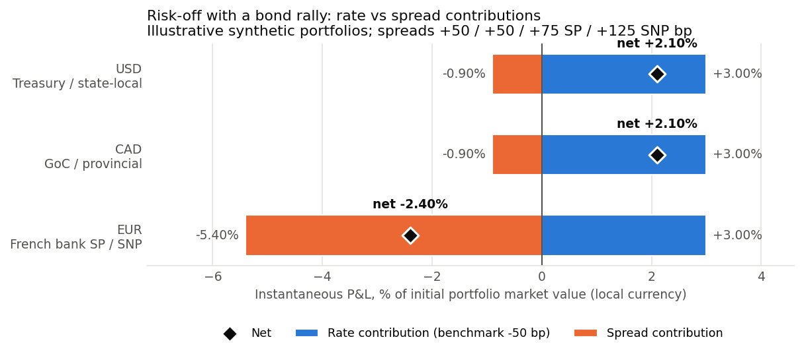

# Credit Risk Management: Theory and Application

Scenario repricing of three synthetic bond portfolios - Université Paris Dauphine

This project compares how three stylised fixed-income portfolios react to interest-rate and credit-spread shocks:

| Portfolio | Benchmark sleeve | Spread-bearing sleeve |
|---|---|---|
| USD | US Treasuries (70%) | Taxable US state/local debt (30%) |
| CAD | Government of Canada (70%) | Canadian provincial debt (30%) |
| EUR | French bank senior preferred (70%) | French bank senior non-preferred (30%) |

Results are instantaneous mark-to-market changes in local currency, expressed as a percentage of initial portfolio market value. The exercise is conditional scenario analysis: it does not forecast defaults, estimate macro-to-spread elasticities or say anything about the ranking of real portfolios.

## Method

Each sleeve *i* has a market-value weight *w*, a benchmark (rate) duration *D_rate* and a spread duration *D_spread*. For a benchmark shock Δy and a spread shock Δs, both in basis points:

```
rate contribution   = -w × D_rate   × Δy / 10,000
spread contribution = -w × D_spread × Δs / 10,000
```

Portfolio P&L is the sum over sleeves. All sleeves use a 6-year benchmark duration. Government sleeves have zero spread duration (benchmark-relative convention); every other sleeve has a 6-year spread duration. Convexity, carry, roll-down, default losses and FX are outside the scope.

## Data

Daily 10-year benchmark yields for 2022, downloaded at run time:

| Currency | Source | Series |
|---|---|---|
| USD | Federal Reserve H.15 via FRED | `DGS10` - 10-year constant maturity Treasury yield |
| CAD | Bank of Canada Valet | `BD.CDN.10YR.DQ.YLD` - 10-year Government of Canada benchmark bond yield |
| EUR | ECB Data Portal | `YC.B.U2.EUR.4F.G_N_A.SV_C_YM.SR_10Y` - 10-year AAA euro-area government spot rate |

Cleaning rules: series are parsed by column name, source missing markers are dropped, and non-numeric values or conflicting duplicate dates stop the historical case. The three date indexes are intersected, the last common date of each month is kept (12 observations required, no interpolation or forward filling), and the historical shock is the change from January month-end to December month-end. Only within-series changes are used, because the three series measure different instruments.

The Bank of Canada series `V39055` named in the original brief is no longer published on Valet (HTTP 404); `BD.CDN.10YR.DQ.YLD` is the current 10-year benchmark series and is used instead. The choice is recorded in `outputs/source_manifest.csv`.

## Scenarios

| Scenario | Benchmark move | US state/local | CA provincial | EUR senior preferred | EUR senior non-preferred |
|---|---|---:|---:|---:|---:|
| January month-end to December month-end 2022 benchmark repricing | observed | 0 | 0 | 0 | 0 |
| Common spread widening | 0 bp | +50 | +50 | +50 | +50 |
| Risk-off with a bond rally | -50 bp | +50 | +50 | +75 | +125 |

The two designed stresses are illustrative and carry no claimed historical frequency.

## Results

### Observed benchmark moves

Common observation dates: **2022-01-31** and **2022-12-30**.

| Currency | Jan yield | Dec yield | Change |
|---|---:|---:|---:|
| USD | 1.79% | 3.88% | +209.00 bp |
| CAD | 1.78% | 3.30% | +152.00 bp |
| EUR | 0.0276% | 2.5553% | +252.78 bp |

### Portfolio results (illustrative, % of initial market value)

| Scenario | USD | CAD | EUR |
|---|---:|---:|---:|
| 2022 benchmark repricing (rate only) | -12.54% | -9.12% | -15.17% |
| Common spread widening | -0.90% | -0.90% | -3.00% |
| Risk-off: rate contribution | +3.00% | +3.00% | +3.00% |
| Risk-off: spread contribution | -0.90% | -0.90% | -5.40% |
| Risk-off: net | +2.10% | +2.10% | -2.40% |



### Sensitivities

| Test | USD | CAD | EUR |
|---|---|---|---|
| Spread-bearing weight 10 / 30 / 60%, common widening | -0.30 / -0.90 / -1.80% | -0.30 / -0.90 / -1.80% | -3.00 / -3.00 / -3.00% |
| Senior non-preferred weight 10 / 30 / 60%, risk-off (net) | - | - | -1.80 / -2.40 / -3.30% |
| Spread duration 4 / 6 / 8 years, common widening | -0.60 / -0.90 / -1.20% | -0.60 / -0.90 / -1.20% | -2.00 / -3.00 / -4.00% |

### Interpretation

- **The common widening isolates spread-bearing weight.** Every spread-bearing sleeve receives the same +50 bp at the same spread duration and benchmarks do not move, so the only difference between portfolios is the share of spread-bearing holdings: 30% in USD and CAD against 100% in EUR. For the same reason, the EUR result does not depend on the senior preferred / non-preferred mix.
- **The risk-off scenario also changes the shocks.** The -50 bp rally adds +3.00% to every portfolio, but the spread shocks now differ by sleeve. The EUR spread loss of -5.40% combines its 100% spread-bearing weight (-3.00% at a uniform +50 bp) with the larger assumed bank spread moves (a further -2.40%).
- **The 2022 case is rate-only.** It reprices the portfolios for the observed 10-year moves and says nothing about 2022 credit spreads.

### Validation

The script checks that weights sum to one, a zero shock gives zero P&L, 100 bp equals 0.01, higher rates and spreads lower value, contributions reconcile before rounding, the EUR common-stress result is invariant to the seniority mix, and the base results match the expected values (common widening -0.90 / -0.90 / -3.00%; risk-off net +2.10 / +2.10 / -2.40%). All 16 checks pass; see `outputs/validation_checks.csv`.

## Limitations

- Holdings, weights and durations are synthetic; no actual portfolio data or sensitivities are used.
- First-order duration approximation only, with weights held at their pre-shock values.
- The 10-year move is applied as a parallel shock.
- The EUR benchmark is the AAA euro-area curve, a public proxy rather than an OIS or French government curve.
- Results are never aggregated across currencies.

## Running the model

Requires Python 3.9+.

```bash
pip install -r requirements.txt
python credit_risk_scenarios.py
```

Options:

| Option | Effect |
|---|---|
| `--outdir DIR` | Write outputs to `DIR` (default `outputs`) |
| `--usd-csv`, `--cad-csv`, `--eur-csv` | Use local CSV exports instead of downloading |
| `--cad-series ID` | Use another Bank of Canada Valet series |
| `--offline` | Do not download; run the designed stresses and any local CSVs only |

Exit code is `0` when every check passes, `2` when the historical data could not be validated (the designed stresses still run) and `1` when a model check fails.

## Outputs

| File | Content |
|---|---|
| `source_manifest.csv` | URLs, series definitions, retrieval timestamps, checksums and cleaning counts |
| `raw/` | Raw source files as downloaded |
| `benchmark_levels_clean.csv` | Cleaned daily yields with common-date flags |
| `benchmark_monthly_common.csv` | Month-end common observations |
| `historical_benchmark_moves.csv` | January-to-December changes in bp |
| `assumptions_inputs.csv` | Sleeve and scenario inputs, each labelled observed or illustrative |
| `sleeve_contributions.csv` | Rate and spread contributions by sleeve and scenario |
| `portfolio_summary.csv` | Portfolio-level results |
| `sensitivity_composition_duration.csv` | Composition and spread-duration sensitivities |
| `validation_checks.csv` | Check results |
| `risk_off_contributions.png` | Risk-off chart |
| `RESULTS.md` | Full results report |
